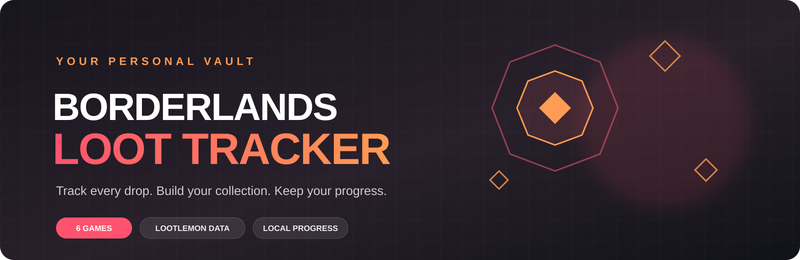
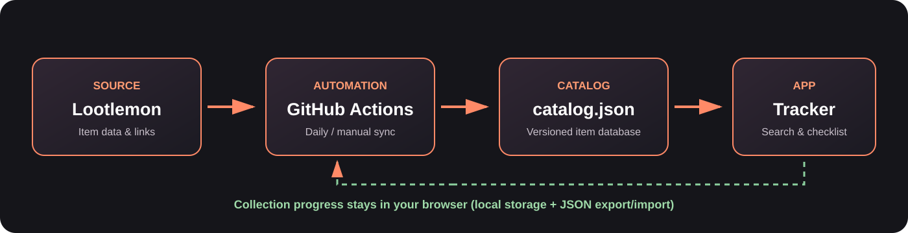

<div align="center">



# Borderlands Loot Tracker

**Your personal vault for the Borderlands universe.**  
A clean, browser-based loot checklist that helps you track collectible gear across the series, keep your collection organized, and stay up to date with Lootlemon.

[](https://fuyukaijanaidesu.github.io/Borderlands-Loot/)
[](https://github.com/fuyukaijanaidesu/Borderlands-Loot/actions)

[Launch tracker](https://fuyukaijanaidesu.github.io/Borderlands-Loot/) · [Download latest release](https://github.com/fuyukaijanaidesu/Borderlands-Loot/releases/latest) · [Report a bug](https://github.com/fuyukaijanaidesu/Borderlands-Loot/issues)

</div>

---

## ✨ What is it?

Borderlands Loot Tracker is a personal collection checklist for the Borderlands games. Browse the catalog, find a specific weapon or piece of gear, mark it as collected, and see your completion progress update instantly.

The project combines a static web app with an automated catalog synchronization pipeline. There is no account, backend service, or database server to configure: the app runs in your browser, and your collection progress stays in your browser unless you export it.

## 🎮 Supported games

| Game | Catalog |
|---|---|
| Borderlands | Included |
| Borderlands 2 | Included |
| Borderlands: The Pre-Sequel | Included |
| Borderlands 3 | Included |
| Tiny Tina's Wonderlands | Included |
| Borderlands 4 | Included |

*Tales from the Borderlands* and *New Tales from the Borderlands* are intentionally not listed because they do not have the collectible gear catalog this tracker is designed for.

## 🚀 Features

- **Collection checklist** — mark items as `Collect` / `Collected` and track completion by game and across the whole series.
- **Fast search** — search item names and available item metadata.
- **Useful filters** — narrow the catalog by item category and available attributes; sort by name, rarity, or content.
- **Lootlemon item details** — see the available item properties, rarity, manufacturer, elements, content and source link where the catalog provides them.
- **Copy Code** — copy an item's original Lootlemon code when one is available.
- **Stable card interaction** — collecting an item updates that card in place instead of rebuilding the entire list.
- **New item notice** — get an in-app notice when catalog synchronization discovers new entries.
- **Portable progress** — collection state is stored locally in your browser and can be exported or restored as JSON.
- **Automatic catalog updates** — GitHub Actions can synchronize the catalog on a schedule or on demand.
- **Safety snapshots** — the sync workflow creates a catalog backup before applying updates.

## 🧭 How catalog updates work

The catalog is sourced from [Lootlemon](https://www.lootlemon.com/). A GitHub Actions workflow checks the source, parses available item data, and updates the version-controlled catalog. The app then reads that catalog when it loads.



The synchronization process is designed to be conservative:

1. Existing catalog data is backed up before changes are applied.
2. Newly discovered items are added to the catalog.
3. Entries that disappear from the source are archived rather than silently discarded.
4. A sync report and Git diff make catalog changes reviewable.

Catalog parsing depends on Lootlemon's page structure. If the source changes its markup, the parser may need an update; automated tests help catch regressions.

## 💾 Your collection and backups

**Your collected-item progress is local to the browser.** It is not automatically uploaded to GitHub or synchronized between devices.

- Use **Full Backup / Export** in the app to save your progress as a JSON file.
- Use **Restore / Import** to bring that progress back later or on another device.
- The sync workflow updates the shared item catalog; it does not overwrite an individual user's browser collection.
- Before catalog synchronization, the repository workflow saves a timestamped catalog snapshot under `backups/`.

For a new browser, PC, or phone, export your progress on the old device and import the JSON file on the new one.

## 🖥️ Use the tracker

### Option 1 — Open online

The easiest way is to use the hosted version:

**[Open Borderlands Loot Tracker](https://fuyukaijanaidesu.github.io/Borderlands-Loot/)**

### Option 2 — Run locally on Windows

1. Download the [latest release ZIP](https://github.com/fuyukaijanaidesu/Borderlands-Loot/releases/latest).
2. Extract the archive to a folder.
3. Double-click `start.bat`.
4. Open the local address shown in the console (normally `http://127.0.0.1:8765/`).

Keep the console window open while using the app. Close it to stop the local server. The launcher binds to localhost, so the app is intended for use on your own device.

No Node.js installation or build step is required. Python 3 is used by the local launcher; see [START_HERE.md](START_HERE.md) for troubleshooting and alternate startup instructions.

## 🧪 Development and tests

The project is a lightweight static frontend with a Python catalog synchronizer.

- Frontend: HTML, CSS, vanilla JavaScript
- Catalog: `data/catalog.json`
- Synchronizer: `scripts/sync_lootlemon.py`
- UI regression tests: `tests/app.test.cjs`
- Sync/parser tests: `tests/test_sync_lootlemon.py`

Run the test suites locally:

```bash
# Python parser tests
python -m unittest tests.test_sync_lootlemon -v

# UI tests (requires Node.js and jsdom)
npm install --no-save --no-package-lock jsdom@26
node --test tests/app.test.cjs
```

To run the catalog synchronizer manually:

```bash
pip install -r requirements.txt
python scripts/sync_lootlemon.py
```

The scheduled sync and UI checks are available in the repository's [GitHub Actions](https://github.com/fuyukaijanaidesu/Borderlands-Loot/actions).

## 🛠️ Project structure

```text
.
├── assets/
│   ├── app.js                 # Search, filters, rendering and collection state
│   └── styles.css             # Responsive interface
├── data/
│   └── catalog.json           # Synchronized item catalog
├── scripts/
│   └── sync_lootlemon.py      # Lootlemon catalog synchronizer
├── tests/                     # UI and parser regression tests
├── backups/                   # Catalog snapshots created by sync
├── docs/images/               # README illustrations
├── index.html
├── start.bat                  # Windows local launcher
└── START_HERE.md
```

## 📌 Data source and credits

Item information and source links are derived from [Lootlemon](https://www.lootlemon.com/). Borderlands and related game names and assets are the property of their respective owners. This is an unofficial fan-made project and is not affiliated with or endorsed by Gearbox Entertainment, 2K, or Lootlemon.

## 🤝 Contributing

Bug reports, parser fixes, and suggestions are welcome. Please open an [issue](https://github.com/fuyukaijanaidesu/Borderlands-Loot/issues) with steps to reproduce the problem and, when possible, the affected game and item.

---

<div align="center">

**Made for the vault hunters who want to collect it all.**

[Open the tracker ↗](https://fuyukaijanaidesu.github.io/Borderlands-Loot/)

</div>
